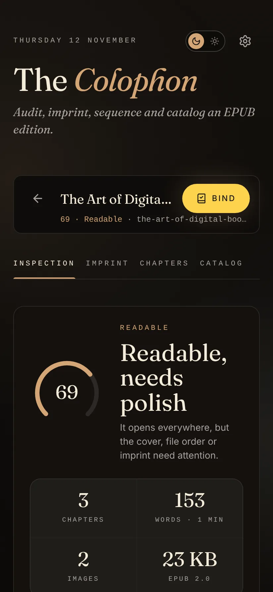
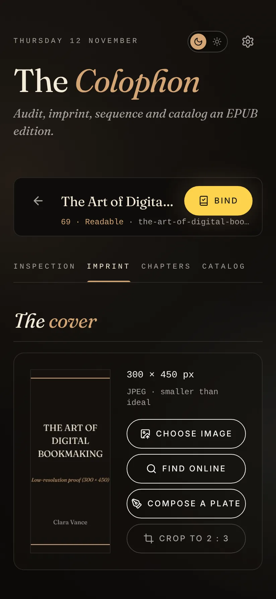
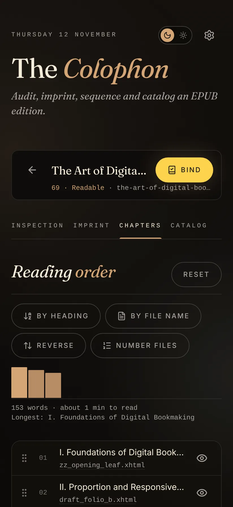
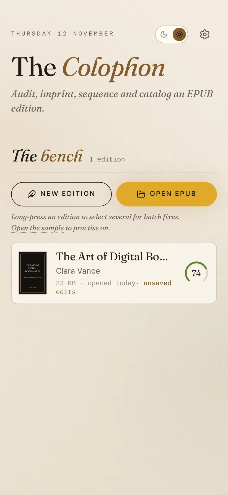

<p align="center"></p>

<h1 align="center">Colophon</h1>

<p align="center"><em>Audit, imprint, sequence and catalog an EPUB edition.</em></p>

<p align="center">
  Android&nbsp;·&nbsp;iOS&nbsp;·&nbsp;Web&nbsp;·&nbsp;<a href="https://github.com/not-mehul/Colophon/releases/latest">Latest release</a>&nbsp;·&nbsp;MIT&nbsp;·&nbsp;Created by <strong>Mehul Sen</strong>
</p>

---

Colophon is an edition inspector, imprint editor and bindery for EPUB files. Open an EPUB, see how well it is put together, fix its metadata, cover, chapter order and contents, and bind a clean copy. It runs in the browser and as an Android and iOS app, and everything stays on your device.

<p align="center">
  
  
  
  
</p>

## Features

- **The bench.** Recent editions as cards with their scores, sorted by recency, score (weakest first) or title. Long-press to select several and fix them in one go (cover tags, orphan files, numbered chapter files, safe validation fixes, the file name template), remove them, or send them to BookShelf.
- **Inspection.** A score out of 100 over seven checks; a validation list in the manner of EPUBCheck (missing files, broken links, missing fonts and images, XHTML that isn't well formed) with one-tap fixes; an accessibility row (alt text, languages, reading order, EPUB Accessibility 1.1 metadata); and a report card to share. Each check shows what your edits have gained, and *Most to gain* jumps to the check with the most points left.
- **Imprint.** Title, authors, ISBN, publisher, language, series, subjects and synopsis, with the date picked on a calendar. The ISBN's check digit is checked as you type, with the corrected or ISBN-13 form offered.
- **Covers.** Choose one, find one online, compose a typographic plate (Classic, Minimal, Noir or E-ink), and crop to 1600 × 2400.
- **Chapters.** The shape of the book, one bar per chapter as tall as it is long, with reading time and any suspiciously short chapters. Drag to reorder, rename or number the files, preview a chapter, edit the table of contents (written to both the nav and the NCX), and set the bound file's name from a template.
- **Find and replace** across every chapter, with each match shown in context first. Only the text you read changes; markup, links and styles are left alone. Match case and whole words, with Undo.
- **Oversized images.** Pictures far bigger than any screen (over 2000 px or 1 MB) are listed under Inspection, and one tap shrinks them to 1600 px in the same format, so the book opens and sends faster.
- **Catalog.** Look up Google Books, Open Library, ISBNdb or a custom catalog by title or by an ISBN typed or scanned with the camera. Results are kept, so earlier searches work offline. Import fields one by one, and undo any import.
- **New edition.** A four-step builder that sets a Markdown or text manuscript as an EPUB 3 with a nav, an NCX and accessibility metadata.
- **The proof.** Before binding, every change is listed with the old value struck through over the new one, grouped like the tabs. Put back any single change, or all of them.
- **Bind.** Edits are saved as you make them, so an edition reopens where you left it. Binding writes a clean copy (`Documents/Colophon/` in the apps, a download in the browser).
- **Open with Colophon.** Open an EPUB from any app on Android or iOS, and *Send to BookShelf* logs the book there in one tap. On Android, *Read in Rosetta* hands the edition to Rosetta as a file, ready to read.
- **Keyboard shortcuts** in the browser: Ctrl/⌘ S binds, Ctrl/⌘ O opens, Ctrl/⌘ Z undoes, 1–4 switch tabs and P opens the proof.
- **A little delight.** A shower of printer’s sorts when your edits bring an edition to 100, an idle composing stick to play with, and four easter eggs, counted in Settings. All of it respects reduced motion.

## Private by design

Your files never leave the device. Colophon talks to a catalog or a cover host only when you search, and API keys are kept in the platform's secure storage (the Keychain on iOS, the Android Keystore).

## Install

- **Android:** download the signed APK from the [latest release](https://github.com/not-mehul/Colophon/releases/latest) and open it on your phone.
- **iOS:** build it from source with Xcode (see below).
- **Web:** run `npm run build` and host `dist/` anywhere.

## The Dusk & Dawn apps

Colophon is one of six apps by Mehul Sen that share one design system, [Editorial Dusk & Dawn](https://github.com/not-mehul/dusk-dawn), and a common link scheme, so they can hand things to each other.

| App | What it is for |
|---|---|
| [Waymark](https://github.com/not-mehul/Waymark) | Your whole trip, offline: flights, stays, plans and costs on one timeline |
| [BookShelf](https://github.com/not-mehul/BookShelf) | Books, films, shows and the lines worth keeping |
| [Ledger](https://github.com/not-mehul/Ledger) | A record of cities, scored on what matters to you |
| [Colophon](https://github.com/not-mehul/Colophon) | Inspect, fix and rebind EPUB editions |
| [Rosetta](https://github.com/not-mehul/Rosetta) | A quiet library and reader for books, papers and notes |
| [Mise](https://github.com/not-mehul/Mise) | Recipes from anywhere, cooked one step at a time |

## Build from source

Svelte 5 and TypeScript, built by Vite, with Dexie for storage and Capacitor 8 for Android and iOS. You need Node 22.12 or later.

```sh
npm install
npm run dev          # http://localhost:5173
npm run check        # tokens, lint, literal colours, typecheck, unit tests
npm run android      # build, sync and open Android Studio
npm run ios          # build, sync and open Xcode
```

[docs/DEVELOPMENT.md](docs/DEVELOPMENT.md) covers the native apps, the project layout and the design tokens. [RELEASING.md](RELEASING.md) covers signing and releases.

## Credits

Colophon is designed and built by **Mehul Sen** ([@not-mehul](https://github.com/not-mehul)).

- Catalog data: [Google Books](https://books.google.com), [Open Library](https://openlibrary.org) and [ISBNdb](https://isbndb.com).
- Libraries: fflate (MIT), Dexie (Apache 2.0), ZXing (Apache 2.0) and [Lucide](https://lucide.dev) icons (ISC).
- Fonts and design: Fraunces (SIL Open Font License) through [dusk-dawn](https://github.com/not-mehul/dusk-dawn).

## Licence

[MIT](LICENSE) © 2026 Mehul Sen.
